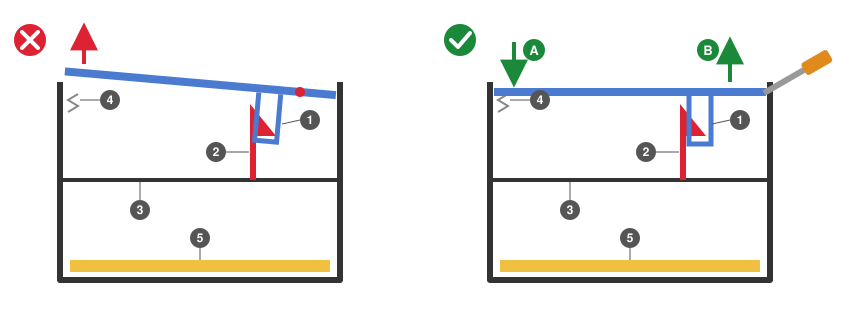
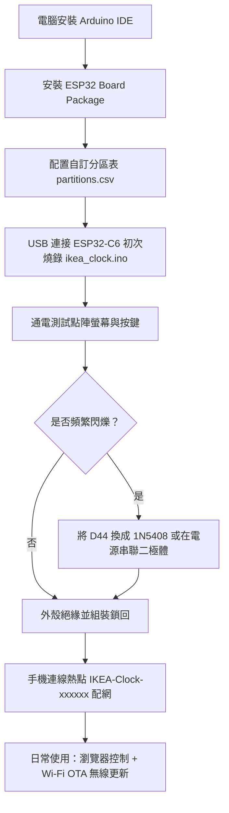

# IKEA KORTLINJE LED 點陣鬧鐘改裝 ESP32 智慧物聯網時鐘完整實施指南

本指南整合開源專案 [`kobebeefg/ikea-clock-lab`](https://github.com/kobebeefg/ikea-clock-lab) 與 [`VIPnytt/Kortlinje`](https://github.com/VIPnytt/Kortlinje) 的逆向研究成果，提供一套**硬體利用率接近 100%**、難度適中且支援**無線 OTA 更新**的完整改裝方案。

> 目前版本 **v0.1**：本指南描述的是改裝的完整目標。v0.1 已完成的是模擬器與韌體模組（見 `retro_clock_features_spec.md`「七、實施排程與驗收準則」）；主程式整合、按鍵與聲音待硬體焊接完成後處理，拆機與焊接的照片教學整理中。改裝風險請見 `README.md` 的免責聲明。

---

## 一、 改裝目標與成果

改裝完成後，這台原價約幾百元台幣的 IKEA 鬧鐘將獲得以下全新能力：
* **全機硬體完全接管**：42×9 點陣 LED 主螢幕、5 顆側邊狀態指示燈（AM/PM/鬧鐘1/鬧鐘2/貪睡）、頂部與背面全部 8 顆實體按鍵、內建蜂鳴器。
* **智慧連網生態**：自動透過 Wi-Fi 與 NTP 伺服器同步精確時間（永不跑慢）、內建 Web 伺服器可由手機免安裝 App 直覺設定。
* **雙溫感顯示**：同時支援雲端抓取「戶外即時氣象與天氣圖示」與底座「室內真實溫度」。
* **復古盲盒鬧鐘與像素怪獸**：13 款向經典遊戲致敬的隨機盲盒鬧鐘動畫，以及原創的像素怪獸養成（詳見 `retro_clock_features_spec.md`）。
* **豐富客製玩法**：手機瀏覽器 42×9 畫布自由塗鴉、自訂文字跑馬燈、客製鬧鐘、整點報時音效、小遊戲與動畫輪播。
* **日後維護零門檻**：組裝蓋回外殼後，後續更新功能或二次開發**完全走 Wi-Fi 無線 OTA 燒錄**，無需再次拆機插線。

---

## 二、 材料與工具清單 (BOM)

### 1. 核心硬體與電子小料
| 項目 | 建議規格 / 型號 | 數量 | 預估費用 | 用途說明 |
| :--- | :--- | :---: | :---: | :--- |
| **主控開發板** | **Seeed Studio XIAO ESP32-C6**（**強烈建議購買「未焊排針」裸板**） | 1 片 | NT$ 345 ~ 450 | 核心大腦，體積超小（約 21×17.5 mm），完全免改程式腳位。*（平替款：ESP32-C3 SuperMini 約 NT$ 90）* |
| **飛線線材** | **30AWG OK線**（單芯鍍錫線）或 **30AWG 特軟矽膠線** | 1 捲 | NT$ 30 ~ 50 | 用於極小焊盤飛線，質地柔軟好彎折，不易拉扯掉脆弱焊盤。 |
| **絕緣膠帶** | **卡普頓高溫膠帶 (Kapton)** / 金手指膠帶 | 1 捲 | NT$ 20 ~ 30 | 貼在 ESP32 底座與原板可能碰觸部位，防金屬短路與固定線材。 |
| **固定膠** | 薄型雙面泡棉膠或無痕膠帶 | 少許 | 現有 | 將 ESP32 穩固黏貼於機身內部平整塑膠壁上。 |
| **分壓電阻** | **10kΩ 電阻**（1/4W 一般電阻或貼片） | 1 顆 | NT$ 1 | **（選配）** 用於接管底座 NTC 溫度傳感器，做電阻分壓測溫。 |
| **降壓二極體** | **1N5408**（或 1N4007）整流二極體 | 1~2 顆 | NT$ 2 ~ 5 | **（備用）** 若實測螢幕出現頻繁閃爍，用於降低驅動供電壓（不閃爍則免用）。 |

### 2. 必備工具
* **溫控電烙鐵**（搭配細尖頭或刀頭）、細焊錫絲（建議 0.6mm 或 0.8mm 含鉛/無鉛焊錫）。
* **助焊劑 (Flux / 焊油)**（**靈魂工具**，拆 SMD 電阻與焊細線必備）。
* **精密鑷子**（夾取貼片電阻與導線扶正）。
* **斜口鉗 / 剪刀**（剪斷按鍵原線路與剝線）。
* **精密十字螺絲起子**（拆卸外殼 13 顆螺絲）。

---

## 三、 完整接線對照總表

所有腳位標號均以 **Seeed Studio XIAO ESP32-C6** 為基準：

```
       IKEA 主機板 / 零件端                      XIAO ESP32-C6 引腳
┌─────────────────────────────────┐           ┌────────────────────┐
│ U1 CLK 焊盤 (拆 R1 後左側)      ├───────────┤ D5  (GPIO 23)      │
│ U1 DATA 焊盤 (拆 R37 後左側)    ├───────────┤ D6  (GPIO 16)      │
│ U2 CLK 焊盤 (拆 R4 後左側)      ├───────────┤ D7  (GPIO 17)      │
│ U2 DATA 焊盤 (拆 R12 後左側)    ├───────────┤ D8  (GPIO 19)      │
│ U4 CLK 焊盤 (拆 R77 後左側)     ├───────────┤ D9  (GPIO 20)      │
│ U4 DATA 焊盤 (拆 R78 後左側)    ├───────────┤ D10 (GPIO 18)      │
├─────────────────────────────────┤           ├────────────────────┤
│ 機身頂部按鍵 (TOP-KEY 紅線)     ├───────────┤ D2  (GPIO 2 / ADC) │
│ 機身頂部按鍵 (TOP-KEY 黑線)     ├───────────┤ 3V3 供電           │
│ 機身背面按鍵 (POWER 黑線)       ├───────────┤ D1  (GPIO 1 / ADC) │
│ 機身背面按鍵 (POWER 藍線)       ├───────────┤ 3V3 供電           │
├─────────────────────────────────┤           ├────────────────────┤
│ 右前腳蜂鳴器 (BUZ 紅線)         ├───────────┤ D3  (GPIO 21 / PWM)│
│ 右前腳蜂鳴器 (BUZ 白線)         ├───────────┤ GND 接地           │
├─────────────────────────────────┤           ├────────────────────┤
│ 原板 5V 電源正極                ├───────────┤ 5V (切勿接 3V3!)   │
│ 原板 GND 電源負極               ├───────────┤ GND 接地           │
├─────────────────────────────────┤           ├────────────────────┤
│ (選配) 右前腳溫度感測 (黑線)    ├───────────┤ D0  (GPIO 0 / A0)  │
│ (選配) 右前腳感測共用 (藍線)    ├───────────┤ GND 接地           │
│ └─ 需在 3.3V 與 D0 間跨接 10kΩ ┘           └────────────────────┘
```

> [!CAUTION]
> 原板電源輸出給 ESP32 時，請務必接在 XIAO ESP32-C6 的 **5V 腳位**，千萬不要誤接至 **3V3 腳位**，否則會直接燒毀 ESP32 的 LDO 穩壓晶片。

---

## 四、 逐步改裝施工流程

### 第一步：拆卸外殼與內部整理
> [!WARNING]
> 拆外殼是本改裝第一個難關：參考的兩份上游教學都沒有說明卡榫結構，方向錯了會越拆越緊，作者實測卡了將近 20 分鐘。**請先看完下方示意圖再動手，不要硬拉左側。**

1. 取出電池蓋，卸下電池倉內與周圍的固定螺絲。
   > 📷 **待補照片**：背面全景，標出所有螺絲位置。
2. 拆背蓋：**先把左側壓回原位，再從右側往外撬**。
   * **結構**：真正固定背蓋的只有**右側單側的反向倒勾卡榫**：背蓋內側往下伸出一個 U 形扣環，套住機身內部支架上的倒勾。卡榫在殼內、靠近右側，從外面看不到。左側沒有卡榫，只靠電池彈簧片輕微頂住，所以很容易被拉開。
   * **常見錯誤**：先把左側往外拉。背蓋會繞著卡榫附近轉動，扣環被槓桿壓向倒勾，右側反而越拉越緊，怎樣都拔不出來。
   * **正確做法**：
     1. 若左側已經被拉開，先把左側**完全壓回**正確位置，讓背蓋整片貼平。
     2. 用一字起子或片狀撬殼工具插入**右側接縫**，直接對背蓋右端**向外**施力。倒勾的壓力會被正確釋放，背蓋就能脫出。

   

   > 📷 **待補照片**：從外部看的右側接縫與起子插入位置；拆下後背蓋內側 U 形扣環與機身支架上倒勾的特寫（讓讀者對照示意圖）。
3. 觀察主機板與各組出線（頂部按鍵排線、背面按鍵排線、右前腳 5 芯排線）。
   > 📷 **待補照片**：分離後內部全景；三組排線與連接位置標註。

### 第二步：解焊切斷原廠主控（關鍵難點）
為了讓原廠主控晶片徹底「靜音」，需斷開它傳送給 LED 驅動晶片的訊號：
1. 找到顯示晶片 U1、U2、U4 旁的 6 顆極小貼片電阻：
   * **U1 旁**：`R1`、`R37`
   * **U2 旁**：`R4`、`R12`
   * **U4 旁**：`R77`、`R78`
   > 📷 **待補照片**：主機板全景標出 U1 / U2 / U4 與 6 顆電阻位置；每組電阻特寫（放大鏡或微距）。
2. 在電阻上塗抹少量助焊劑，烙鐵輕點兩端即可輕鬆將這 6 顆電阻解焊取下。
3. **電阻取下後，我們只需要將線焊接在「左側焊盤」**（通往 LED 驅動晶片的那一端），右側通往舊主控的焊盤放空即可。
   > 📷 **待補照片**：電阻解焊前 / 後對照；標出「左側焊盤」是哪一端。

### 第三步：焊接 6 條 LED 面板訊號線
1. 將 30AWG 細線先上一點薄錫，剪取約 8~10 cm 長度。
2. 小心焊接在 6 個左側焊盤上，焊好後立即用少許卡普頓膠帶貼覆固定，避免組裝時線路晃動拉扯導致焊盤脫落。
3. 將這 6 條線分別焊至 XIAO ESP32-C6 的 **D5 ~ D10** 引腳（參照接線表）。
   > 📷 **待補照片**：6 條線焊在焊盤上的特寫與卡普頓膠帶固定方式；XIAO 端 D5 ~ D10 焊點。

### 第四步：剪線接管按鍵與蜂鳴器
1. **頂部按鍵 (TOP-KEY)**：
   * 剪斷 **黑線**（接 ESP32 3V3）與 **紅線**（接 ESP32 D2）。
   * **白線（GND）保留不動**。原主控板側的斷線剪平並貼膠帶絕緣。
2. **背面按鍵 (POWER)**：
   * 剪斷 **黑線**（接 ESP32 D1）與 **藍線**（接 ESP32 3V3）。
   * **白線與紅線保留不動**。原主控板側的斷線剪平絕緣。
3. **蜂鳴器 (BUZ)**：
   * 剪斷 **紅線**（接 ESP32 D3）與 **白線**（接 ESP32 GND）。
   * 原主控板側的斷線剪平絕緣。
   > 📷 **待補照片**：三組排線的顏色與剪斷位置（剪之前拍，標示哪幾條要剪）；斷線絕緣處理後的樣子。

### 第五步：（選配）接管底座室內溫度感測器
1. 觀察通往右前腳的 5 芯排線（原先有紅、白、黃、藍、黑）：
   * 紅、白已作為蜂鳴器剪走。
   * 將 **藍線（Common GND）** 剪斷接到 ESP32 的 GND。
   * 將 **黑線（NTC 溫度訊號）** 剪斷接到 ESP32 的 D0 (A0)。
   * 在 ESP32 的 **3V3** 與 **D0** 腳位之間，並聯焊上一顆 **10kΩ 分壓電阻**。
   * 黃線（濕度）暫時保留絕緣即可。
   > 📷 **待補照片**：右前腳 5 芯排線顏色；10kΩ 電阻跨接方式。

### 第六步：電源連接
1. 從原板引出 **5V** 與 **GND**，焊接至 ESP32 的 5V 與 GND。
2. 在 ESP32 背面貼滿卡普頓絕緣膠帶，防止與其他金屬接點接觸。
   > 📷 **待補照片**：原板 5V / GND 取電點位置（標註）；ESP32 背面絕緣後的樣子。

---

## 五、 軟體燒錄與初次配網



### 1. Arduino IDE 環境設定
1. 安裝 Arduino IDE 最新版本。
2. 在「偏好設定」中加入 ESP32 開發板網址，並在開發板管理員安裝 **ESP32 by Espressif Systems**（建議最新 3.x 版本）。
3. 開發板選擇：`Seeed Studio XIAO ESP32C6`。
4. 安裝必備函式庫：`ArduinoJson`（v7 版本）。

### 2. 配置自訂分區表（關鍵步驟）
由於專案包含中英文字型、網頁 UI 與動畫彩蛋，體積超過預設大小，必須使用自訂分區：
* 執行專案隨附的 Python 腳本：
  ```bash
  python3 firmware/setup_ide_partition.py
  ```
* 重新打開 Arduino IDE，在選單 **「工具」$\rightarrow$「Partition Scheme」** 中勾選：
  `IKEA Clock (2 x 1920 KB OTA)`。

### 3. 初次 USB 燒錄與測試
1. 用 USB-C 連接線將 XIAO ESP32-C6 接上電腦。
2. 打開 `firmware/ikea_clock.ino`（v0.1 尚未提供，待硬體整合），按下上傳燒錄。
3. **組裝前測試**：
   * 通電觀察螢幕是否點亮跑出測試字樣。
   * 若面板有持續高頻閃爍現象，代表 3.3V 訊號在 4.6V 供電下邊緣臨界 $\rightarrow$ 此時在 5V 供電線上串聯一顆 **1N5408** 降壓即可瞬間解決。
   > 📷 **待補照片**：首次點亮的畫面；若有換 D44，標出 D44 位置。
   * 試按頂部與背面的 8 顆按鍵，確認功能與聲音正常。

### 4. 首次配網與 OTA 日常使用
1. 確認正常後，整理機身內部線材，用雙面膠將 ESP32 固定在塑膠內壁，鎖回外殼螺絲。
   > 📷 **待補照片**：ESP32 在機殼內的固定位置與走線；蓋回前最後全景。
2. 用手機連線至時鐘發出的 Wi-Fi 熱點 `IKEA-Clock-xxxxxx`。
3. 手機開啟 `http://192.168.4.1/`，輸入家中的 2.4GHz Wi-Fi 帳號密碼並儲存。
4. 時鐘連線後會自動校準時間，之後只需以手機或電腦連入：
   `http://ikea-pixel-clock.local/`
5. **日後無線更新**：需要更新程式時，直接在 Arduino IDE 的序列埠選取網路埠 `ikea-pixel-clock at 192.168.x.x`，點擊上傳即可在數秒內無線完成更新！
