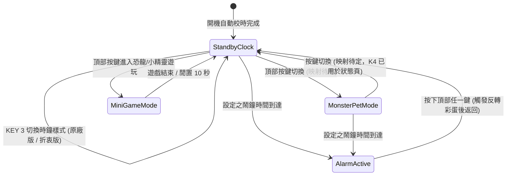

# IKEA KORTLINJE 復古互動系統完整規格書
### 42×9 點陣 LED × 8-bit 蜂鳴器 × 像素怪獸養成 × 隨機盲盒鬧鐘

> 版本：**v0.1**（2026-11-12）—— 軟體邏輯與模擬器階段；按鍵映射、聲音與實機整合待硬體焊接完成後處理（見「七、實施排程與驗收準則 → 延後事項」）。

---

## 一、 系統架構與硬體約束

本規格書專為改裝後的 **IKEA KORTLINJE 智慧時鐘**（主控：Seeed Studio XIAO ESP32-C6）量身訂做，充分發揮硬體特性與極限：

```
                    ┌─────────────────────────┐
                    │  Seeed XIAO ESP32-C6    │
                    └────┬────────┬─────────┬─┘
         6 條驅動線      │        │ D3 腳位 │ 按鍵 ADC (D1, D2)
  ┌──────────────────────┘        │ (PWM)   └──────────────────────┐
  ▼                               ▼                                ▼
┌──────────────────────┐  ┌───────────────┐              ┌──────────────────┐
│  42×9 點陣 LED 螢幕  │  │ 無源蜂鳴器    │              │ 頂部 4 鍵 / 背面 4 鍵 │
│  (超寬橫向 4.67:1)   │  │ (8-bit 音效)  │              │ (實體功能操作交互)  │
└──────────────────────┘  └───────────────┘              └──────────────────┘
```

### 硬體特性約束與設計原則：
1. **螢幕尺寸**：水平 42 像素 × 垂直 9 像素，單色（亮/滅），行掃描。
2. **圖元設計規範**：鬧鐘主題的主角色以 **7×7** 為基準（上下各留 1 像素，避免貼邊窒息感）；場景需要時可放大（如太空侵略者螃蟹怪 `11×8`、寶可夢閃電 `7×8`）。像素怪獸以底部對齊、可用滿 9 排高，最大 `12×9`。所有圖形的唯一來源是模擬器（見「五、點陣圖形」）。
3. **聲音輸出**：利用 ESP32 LEDC PWM 產生單音方波，音域支援 31Hz ~ 4978Hz，並運用快速琶音（Arpeggio）與滑音（Portamento）創造出紅白機 / 街機等級的 8-bit 音色。
4. **按鍵配置**：
   * **時鐘頂部 4 鍵**：日常操作主按鍵（像素怪獸互動 / 遊戲操作 / 鬧鐘解除）。
   * **時鐘背面 4 鍵**：設定鍵、模式切換、音量與亮度微調。

---

## 二、 模式狀態機與時鐘待機顯示規格 (System State Machine & Clock Styles)

系統運作分為四大模式，彼此可透過頂部/背面按鍵或 Web 介面自由切換：



### 時鐘待機顯示規格（移除溫度顯示，保留 2 種可切換樣式）：
1. **樣式 A：IKEA 原廠 / VIPnytt 版 (`original`)**
   * **字體**：`7×9` 雙線加粗字體（`KORTLINJE_FONT_7x9`，垂直筆畫 2px 寬；數字 `1` 為 `6×9` 並自動微調 1 格對齊）。
   * **版面配置**：僅顯示 `HH:MM`（`x = 0, 9` 與 `x = 26, 35`），正中央配置恆亮 `2×2` 大方點冒號（`x = 20..21, y = 1..2, 6..7`）。
2. **樣式 B：折衷版 (`hybrid`，預設啟用)**
   * **字體**：客製 `6×9` 原廠風格雙線粗胖字體（`KORTLINJE_BOLD_6x9`，保留垂直 2px 粗筆畫與圓角）搭配右下角 `3×5` 小數字字體（`KOBEBEEFG_TINY_3x5`）。
   * **版面配置**：左側顯示雙線粗體 `HH:MM`（`x = 1, 8` 與 `x = 18, 25`）＋ 中央恆亮不閃爍 `2×2` 粗冒號（`x = 15..16, y = 1..2, 6..7`）＋ 右下角底部對齊顯示 `SS` 秒數（`x = 34, 38, y = 4..8`）。

---

## 三、 13 大經典復古主題詳解規格

全系列共 **13 款主題**，全部納入「早晨隨機盲盒鬧鐘」中輪播，同時部分主題可作為獨立待機動畫或互動小遊戲。每款主題皆遵循「鬧鐘響起時演出失敗劇情 → 按下任一頂部鍵觸發反轉彩蛋（停留 2.5 秒）→ 返回時鐘」的共通結構。

### 1. 小精靈 (Pac-Man) —— ✅ 已定案參數
* **適用模式**：隨機鬧鐘 / 整點報時 / 待機過場動畫
* **角色與物件點陣規格 (`y = 1..7`)**：
  * **小精靈 (`7×7`)**：標準圓形輪廓（每列寬度 `3-5-7-7-7-5-3`），採街機原版 **3 圖 4 拍步伐綁定循環**（`PAC_CLOSE -> PAC_MID -> PAC_OPEN -> PAC_MID`，綁定 `step % 4`），每前進 1 格推進 1 拍嘴巴，且豆子座標精確對齊 `step % 4 == 0`，使小精靈靠近豆子時張大嘴、抵達豆子座標該格時剛好閉嘴咬掉豆子：
    * `PAC_CLOSE`: `{ 0x1C, 0x3E, 0x7F, 0x7F, 0x7F, 0x3E, 0x1C }`
    * `PAC_MID`:   `{ 0x1C, 0x3E, 0x7C, 0x70, 0x7C, 0x3E, 0x1C }`
    * `PAC_OPEN`:  `{ 0x1C, 0x38, 0x70, 0x60, 0x70, 0x38, 0x1C }`
  * **一般幽靈 (`GHOST1`, `7×7`)**：雙眼鏤空偏右（`0x6D`）使單色視覺明確朝前看（左移時透過 `flipX = true` 自動鏡像朝左看），底部固定為 **4 隻腳 (`0x55`)** 且不做變形切換：
    * `GHOST1`: `{ 0x3E, 0x7F, 0x6D, 0x6D, 0x7F, 0x7F, 0x55 }`
  * **受驚嚇幽靈 (`GHOST_SCARED`, `7×7`)**：採用「方案 2：反白空心外框＋內部兩顆發亮小眼珠」，底部同樣維持 4 隻腳：
    * `GHOST_SCARED`: `{ 0x3E, 0x41, 0x55, 0x41, 0x41, 0x7F, 0x55 }`
  * **能量球 (`POWER_PELLET`, `3×3`)**：`{ 0x02, 0x07, 0x02 }`，位於 `(x = 37, y = 3)`，每 `200ms` 閃爍一次。
* **4 大子場景與動態機率連鎖機制（每趟橫越畫面為 `80` 步）**：
  * **常態機率分佈**：**場景 1 (`40%`)、場景 2 (`40%`)、場景 3 (`10%`)、場景 4 (`10%`)**。
  * **場景 3 觸發後之連鎖機率**：一旦出現**場景 3**，下一輪出現**場景 4（右至左追擊模式）**的機率自動提高為 **`90%`**（其餘 10% 分配為場景 1 `4%`、場景 2 `4%`、場景 3 `2%`）；待場景 4 顯示完畢後，自動回復為原先的 `40%, 40%, 10%, 10%`。
  * **各子場景詳細參數**：
    1. **場景 1（預設：由左至右，無能量球，常態 `40%`）**：
       * 移動速率：**`120ms / 格`**（`flipX = false`）。
       * 配置：畫面上排滿 5 顆一般豆子（`dotX = 6, 14, 22, 30, 38`, `y = 4`），無能量球；小精靈在前（`pacX = step - 7`），後方跟著 **3 隻一般幽靈**（`pacX - 10`, `pacX - 19`, `pacX - 28`，間距 9 格）。
    2. **場景 2（由右至左，無能量球，常態 `40%`）**：
       * 移動速率：**`120ms / 格`**（`flipX = true` 面向左方）。
       * 配置：畫面上排滿 5 顆一般豆子（`dotX = 35, 27, 19, 11, 3`, `y = 4`），無能量球；小精靈在前由右向左吃豆（`pacX = 42 - step`），後方跟著 **3 隻一般幽靈**（`pacX + 10`, `pacX + 19`, `pacX + 28`）。
    3. **場景 3（由左至右，含能量球，常態 `10%`）**：
       * 移動速率：**`120ms / 格`**（`flipX = false`）。
       * 配置：前方 4 顆一般豆子（`dotX = 6, 14, 22, 30`）＋ 右側閃爍 `3×3` 能量球（`x = 37, y = 3`）；小精靈在前，後方跟著 **3 隻一般幽靈**（吃掉能量球後，本場景內的幽靈維持一般外觀 `GHOST1`，不主動變為驚嚇狀態，而是將下一輪進入場景 4 的機率提升為 `90%`）。
    4. **場景 4（由右至左追擊模式，常態 `10%` / 場景 3 後 `90%`）**：
       * 移動速率：加速為 **`90ms / 格`**。
       * 配置：畫面上無豆子，**3 隻受驚嚇幽靈 (`GHOST_SCARED`)** 在前方由右向左逃跑（`ghostLeadX = 42 - step`，3 隻座標為 `ghostLeadX`, `ghostLeadX + 9`, `ghostLeadX + 18`），小精靈（`flipX = true`）在最後方（`ghostLeadX + 28`）張嘴追擊。
* **蜂鳴器 8-bit 音效**：
  * 響起最經典的 **Pac-Man 開場旋律**。
* **鬧鐘解除互動**：按鍵即刻觸發「小精靈以 `90ms/格` 追擊 3 隻受驚嚇幽靈」並播放下沉滑音，停留 2.5 秒後返回時鐘。

### 2. Chrome 斷網恐龍 (T-Rex Runner) —— ✅ 已定案參數
* **適用模式**：隨機鬧鐘 / 獨立可玩迷你小遊戲 / 待機動畫
* **視覺呈現 (42×9)**：
  * **天空與遠景（三層多樣化視差雲朵群）**：
    * **遠景高空雙峰大雲**：`8×3` 像素（`0x1C, 0x6E, 0xFF`），位於 `y=0`，以最慢速約 `270ms/格` 悠然飄移（每 `17280ms` 剛好飄 1 圈）。
    * **中景蓬鬆中型雲**：`6×2` 像素（`0x0E, 0x3F`），位於 `y=1`，以中速 `180ms/格` 飄移（錯開相位，循環寬度 48 格，每 `17280ms` 飄 2 圈）。
    * **近景迷你小輕雲**：`4×2` 像素（`0x06, 0x0F`），位於 `y=2`，以輕快速率約 `131ms/格` 掠過天際（循環寬度 66 格，每 `17280ms` 飄 2 圈）。
    * **無縫循環**：仙人掌每 `2880ms` 一顆，3 朵雲與恐龍跑步動作都整除 `17280ms`（6 顆仙人掌），整個畫面每 `17.28s` 完全重複一次，韌體可直接寫死成固定動畫。
    * 三朵雲高度、造型與飄速各異，營造深邃空間景深感。
  * **地平線與近景**：
    * 第 8 行連續平整實線，乾淨純粹，視覺穩定不頻閃（無碎石干擾）。
  * **小恐龍與前景圖層保護**：
    * `7×7` 像素，步頻提升至 `60ms/格`，雙腿以 `90ms` 頻率輕快交替，空中維持立姿。
    * **眼睛專屬前景遮罩**：小恐龍永遠繪製在最前景，且眼睛像素（`x=7, y=dinoY+1`）強制執行挖空遮罩，確保與背景飄雲重疊時眼睛永遠保持空白、神韻不被填滿。
  * **障礙物**：`5×4` 經典三叉矮仙人掌（高度 4 像素），緊貼地表，留出充足空中飛躍空間。
  * **跳躍物理**：迅捷彈性拋物線軌跡（總跳躍時程僅約 `540ms`，頂峰滯空 `y=-4` 僅短促停留 `120ms`，允許超出頂部邊界），起跳敏捷、落地下沉乾脆俐落，徹底告別慢動作懸空感。
* **蜂鳴器 8-bit 音效**：
  * 跳躍時短促清脆的 `1500Hz` 高音短嗶聲。
  * 每滿 100 分時播放經典的雙音階升音「登-等！」。
* **鬧鐘解除互動**：鬧鐘響起時恐龍不斷跑動，按下頂部任一鍵 $\rightarrow$ 恐龍帥氣起跳完美越過仙人掌，播放過關音並關閉鬧鈴。

### 3. 超級馬力歐 (Super Mario — World 1-1 全景橫向捲軸導覽) —— ✅ 已定案參數
* **適用模式**：隨機鬧鐘 / 整點報時 / 待機動畫
* **設計理念**：捨棄在 `42×9` 單色低解析度下難以辨識五官的人形主角與瑣碎問號紋路，改以 **`70ms / 像素` 鏡頭橫向捲動**，完整重現 **《超級瑪利歐兄弟 World 1-1》濃縮版全景關卡（總地圖寬度 `140px` 無縫循環）**。
* **關卡物件點陣與座標規格**：
  * **實心懸空小磚塊 (`MARIO_BRICK`, `3×3`)**：`{ 0x07, 0x07, 0x07 }`，採用奇數寬 `3px` 正方形實心磚塊，使正上方的 `3×4` 旋轉金幣完美正中心對齊：
    * **開場單顆彈跳磚塊**：位於 `(worldX = 6, y = 3)`，每 `350ms` 週期向上微彈 `1px` 並於正上方 `(worldX = 6, y = -1)` 閃現旋轉金幣。
    * **經典三連磚平台**：位於 `worldX = 24, 28, 32`（`y = 4`，磚間留 `1px` 磚縫），正上方 `(worldX = 24, 28, 32, y = 0)` 對齊懸掛 3 顆同步翻轉的立體金幣。
  * **立體旋轉金幣 (`MARIO_COIN1~3`, `3×4`)**：採 4 拍立體翻轉循環（`COIN1` 正面中空橢圓 `{ 0x02, 0x05, 0x05, 0x02 }` $\rightarrow$ `COIN2` 側面 `{ 0x02, 0x07, 0x07, 0x02 }` $\rightarrow$ `COIN3` 立面細線 `{ 0x02, 0x02, 0x02, 0x02 }` $\rightarrow$ `COIN2`），每 `110ms` 切換一幀。
  * **小巧栗寶寶 (`MARIO_GOOMBA1/2`, `5×4`)**：精簡為高 4 格的小巧比例（上層 `3px` 傘頂 + 中層 `5px` 寬傘沿 + 下層 `3px` 身體 + 底部單點雙腳 `{ 0x0E, 0x1F, 0x0E, 0x08/0x02 }`），每 `180ms` 左右腳交替踏步，分別於開場區（`worldX = 14..17, y = 4`）與水管峽谷間（`worldX = 55..58, y = 4`）來回巡邏。
  * **高低水管峽谷 (`MARIO_PIPE_S` `7×4` / `MARIO_PIPE_T` `7×6`)**：重現上寬 `7px`（`0x7F`）、下窄 `5px`（`0x3E`）的經典管口比例，矮水管位於 `(worldX = 45, y = 4)`，高水管聳立於 `(worldX = 65, y = 2)`。
  * **跳躍深淵坑洞 (Pit) 與無敵星星 (`MARIO_STAR1/2`, `5×5`)**：`y = 8` 地面實線於 `worldX = 76..79` 斷開 4 格深淵；後方 `(worldX = 83, y = 1..2)` 懸浮一顆每 `100ms` 閃爍光芒、上下跳動的無敵星星。
  * **終點大階梯、旗桿與城堡 (`MARIO_CASTLE`, `7×8`)**：
    * **大階梯金字塔 (`worldX = 92..98`)**：高度由 `1px` 逐列遞增至 `6px`。
    * **終點旗桿 (`worldX = 106`)**：含 `3px` 底座、`y = 0..6` 旗桿與隨風微擺的三角旗幟。
    * **終點城堡 (`worldX = 114, y = 0..7`)**：`{ 0x00, 0x2A, 0x3E, 0x14, 0x7F, 0x77, 0x63, 0x63 }`，具備上層城垛齒口、中層雙窗與底層圓拱大門。
* **蜂鳴器 8-bit 音效**：
  * 經典主題曲前奏（Do-Do-Do, Do-Do, Sol）。
  * 按鍵解除時的經典 **金幣「叮！」音效**（B5 988Hz 瞬間跳至 E6 1319Hz）。
* **鬧鐘解除互動（終點拉旗過關 ＋ 城堡煙火慶祝）**：按下按鍵立即切換至終點特寫鏡頭，旗桿上的三角旗順著旗桿一路滑降到底部，隨後城堡屋頂升起勝利小旗，夜空中依序綻放 **3 朵十字閃爍煙火**！

### 4. 太空侵略者 / 小蜜蜂 (Space Invaders — 100% 街機原版圖騰與雷射擊殺演出) —— ✅ 已定案參數
* **適用模式**：隨機鬧鐘 / 橫向飛行射擊遊戲 / 待機動畫
* **設計理念**：完美復刻 1978 年 Taito 街機原版《Space Invaders》最具代表性的兩大外星怪獸——**招牌螃蟹怪 (`11×8`)** 與 **尖頭烏賊怪 (`8×8`)**，搭配左側上下巡航的防護雷射戰機 (`6×7`) 與街機原版「放射狀散裂爆炸火花 (`8×8`)」，演繹完整的橫向射擊殲滅循環（外星怪獸不發射反擊子彈，維持畫面純淨俐落）。
* **角色與特效點陣規格**：
  * **1 號：街機原版「招牌螃蟹怪」(`INV_CRAB1/2`, `11×8`, 16-bit 編碼)**：
    * `INV_CRAB1` (雙螯朝下、下顎收合)：`{ 0x104, 0x088, 0x1FC, 0x376, 0x7FF, 0x5FD, 0x505, 0x0D8 }`
    * `INV_CRAB2` (雙螯高舉、外腿踢開)：`{ 0x104, 0x58A, 0x5FD, 0x777, 0x7FF, 0x3FC, 0x104, 0x202 }`
  * **3 號：街機原版「尖頭烏賊怪」(`INV_SQUID1/2`, `8×8`)**：
    * `INV_SQUID1` (觸手向外張開)：`{ 0x18, 0x3C, 0x7E, 0xDB, 0xFF, 0x24, 0x5A, 0xA5 }`
    * `INV_SQUID2` (觸手向內彎曲)：`{ 0x18, 0x3C, 0x7E, 0xDB, 0xFF, 0x5A, 0x81, 0x42 }`
  * **街機原版「放射狀散裂爆炸火花」(`INV_EXPLODE`, `8×8`)**：
    * `{ 0x8A, 0x44, 0xA2, 0x11, 0x88, 0x45, 0x22, 0x51 }`
  * **左側防護雷射戰機 (`INV_FIGHTER`, `6×7`)**：
    * `{ 0x30, 0x18, 0x3E, 0x3F, 0x3E, 0x18, 0x30 }`，具備上下對稱雙翼裝甲與正中心（`y + 3`）延伸砲管。
* **動態戰鬥循環規格（每回合 `5400ms` = `90 ticks`，`60ms / tick`）**：
  * **戰機巡航**：固定於 `x = 1`（左側留 `1px` 邊距），以 `y = 1` 為基準，每 `225ms`（每回合 `5400ms` 的 1/24）於 `y = 1 -> 0 -> 1 -> 2` 之間平滑上下巡航移動。
  * **外星編隊往復進逼**：前排 **1 號螃蟹怪 (`x = 16 - marchOffset, y = 0`)** 與後排 **3 號烏賊怪 (`x = 31 - marchOffset, y = 0`)** 每 `337.5ms`（每回合 `5400ms` 的 1/16，整回合剛好往返 2 次，可無縫循環）切換一次肢體張合並同步左右進逼（`marchOffset = 0..4`）。
  * **兩段式雷射擊殺演出**：
    1. **第一發雷射（`tick 4..14`）**：戰機射出 `2px` 高速光彈直擊前排 **1 號螃蟹怪** $\rightarrow$ `tick 15..22` 螃蟹怪炸開成放射狀火花並消失！
    2. **第二發雷射（`tick 36..55`）**：戰機射出第二發光彈穿過前排空隙，直擊後排 **3 號烏賊怪** $\rightarrow$ `tick 56..63` 烏賊怪中彈爆裂成火花！隨後於 `tick 72..76` 編隊重生進入下一輪。
* **蜂鳴器 8-bit 音效**：
  * 戰機發射雷射時的由高向低快速滑音（Laser chirp: `1800Hz -> 400Hz`）。
* **鬧鐘解除互動（奇數粗度置中貫穿波動砲）**：按下按鍵時，戰機定格於 `(x = 1, y = 1)`，正中心砲管對齊 `y = 4`，瞬間發射**奇數粗度置中貫穿雷射**（`y = 4` 核心主光束恆亮 ＋ 上下對稱 `y = 3`、`y = 5` 共 `3px` 寬度高速閃爍），同時引爆場上兩隻怪獸，閃爍爆炸火花後將畫面一掃而空！

### 5. 寶可夢 Game Boy (Pokemon — 4 大隨機遇敵幾何轉場 ＋ 7×7 精緻精靈球 ＋ 戰鬥介面與十萬伏特) —— ✅ 已定案參數
* **適用模式**：隨機鬧鐘
* **設計理念**：結合初代 Game Boy《寶可夢 紅/綠/皮卡丘》最具辨識度的四大視覺符號——**隨機 4 種野生遇敵幾何切場動畫**、**左側 `7×7` 精緻奇數精靈球（含上紅實心、中間挖空橫帶與圓鈕、下白空心弧底 3 態搖晃）**、**中央上方短 L 型單向扣血 HP 血條與下方 `PIKA / LV 99` 戰鬥文字**、以及**右側 `7×8` 巨型十萬伏特閃電圖騰**。
* **階段 1：野生遇敵快閃 ＋ 4 種隨機幾何切場動畫（`tick 0..15`，每輪重新隨機抽取）**：
  * **開場遇敵快閃 (`tick 0..5`)**：全螢幕黑白交替快閃 3 次。
  * **4 種隨機幾何切場特效 (`tick 6..15`)**：
    1. **特效 0【雙向水平百葉窗拉幕】**：偶數行由左向右、奇數行由右向左交錯掃滿全螢幕。
    2. **特效 1【順時針扇形雷達掃一圈】**：以螢幕正中心 `(20.5, 4.0)` 為圓心，由 12 點鐘方向順時針呈扇形旋轉掃滿 360 度。
    3. **特效 2【外框向內幾何方框漩渦填滿】**：從螢幕四周邊框一圈一圈向正中心收縮填滿。
    4. **特效 3【不等大共邊幾何三角形依序填滿角落與畫面】**：採嚴密共邊三角剖分（Exact Triangulation），以 6 塊大小與斜率各異的三角形依序填滿：**1. 右上角 `(17,0)-(41,0)-(41,5)` $\rightarrow$ 2. 右下角 `(24,8)-(41,5)-(41,8)` $\rightarrow$ 3. 左下角 `(0,3)-(24,8)-(0,8)` $\rightarrow$ 4. 左上角 `(0,0)-(17,0)-(0,3)` $\rightarrow$ 5. 中央偏右斜塊 `(17,0)-(41,5)-(24,8)` $\rightarrow$ 6. 中央偏左斜塊 `(0,3)-(17,0)-(24,8)`**，100% 嚴密填滿無破洞。
* **階段 2：Game Boy 戰鬥畫面與點陣規格（`tick 16..93`）**：
  * **左側 `7×7` 精緻奇數精靈球 (`POKEBALL_7M/L/R`, 位於 `x = 2, y = 1..7`)**：上下各留 `1px` 呼吸空間，隨節拍模擬收服時「咔...咔...」左右搖晃按鈕位移：
    * `POKEBALL_7M` (正中)：`{ 0x1C, 0x3E, 0x77, 0x08, 0x63, 0x22, 0x1C }`
    * `POKEBALL_7L` (左傾)：`{ 0x1C, 0x3E, 0x6F, 0x10, 0x63, 0x22, 0x1C }`
    * `POKEBALL_7R` (右傾)：`{ 0x1C, 0x3E, 0x7B, 0x04, 0x63, 0x22, 0x1C }`
  * **中央上方短 L 型單向扣血 HP 血條 (`x = 12..31, y = 0..1`)**：左端垂直立柱僅高出 1 格 (`(12,0)`) 搭配 `y = 1` 水平血條；自 `tick 34` 遭受十萬伏特攻擊後向左扣血至殘血 (`6px`)，**扣完後維持殘血不再補滿**。
  * **中央下方戰鬥文字 (`x = 13..31, y = 3..7`)**：採用統一完整顯示左直豎的 `4×5` 標準像素字體，交替顯示 **`PIKA`** 與 **`LV 99`**。
  * **右側 `7×8` 巨型閃電圖騰 (`POKE_BOLT_BIG`, 位於 `x = 34, y = 0..7`)**：`{ 0x0E, 0x1C, 0x38, 0x7F, 0x1C, 0x38, 0x30, 0x40 }`，帶放電閃爍動態。
* **蜂鳴器 8-bit 音效**：
  * 完美還原 Game Boy 8-bit 寶可夢遇敵戰鬥前奏（連續急速的下行與爬升音階）。
* **鬧鐘解除互動（GOTCHA 收服成功）**：按下頂部鍵 $\rightarrow$ 播放捕捉成功清脆四音階，左側 `7×7` 精靈球定格鎖定並於右上角 (`x = 10, y = 1`) 閃爍十字收服星芒，右側以等距緊湊排版（`T` 採用 `3×5` 奇數對稱寬度，消除單字中間多餘空白）清晰顯示 **`GOTCHA`**！

### 6. 街機 Continue 倒數 (Arcade Continue — CRT 光束展開 ＋ 完整 CONTINUE? 巨型倒數 ＋ GAME OVER 砸落沉沒) —— ✅ 已定案參數
* **適用模式**：隨機鬧鐘
* **設計理念**：完美重現經典街機接關倒數與 Game Over 完整劇場（每輪總時長 `14.6 秒` 無縫循環）：結合老式街機 **CRT 水平光束射出與上下對稱展開**、左側完整顯示 **`CONTINUE?`** 單字搭配右側 **`7×9` 滿版巨型雙線粗體倒數數字**、倒數歸零後的 **`GAME OVER` 逐字砸落**、以及最後**全文字往下滑落沉沒消失與黑屏留白停頓**。
* **完整 4 階段動態時序與點陣規格（`cycleMs = elapsed % 14600`）**：
  1. **階段 1：街機 CRT 水平光束射出 ＋ 上下對稱展開（`0 ~ 500ms`）**：
     * **`0 ~ 180ms`**：在螢幕正中央第 5 列（`y = 4`）由左向右快速射出一道橫貫全螢幕的直線光束（`x = 0 -> 41`）。
     * **`180 ~ 500ms`**：以 `y = 4` 光束為軸心，每 `80ms` 向「上下兩側對稱展開 1 格」（`y = 4` $\rightarrow$ `y = 3..5` $\rightarrow$ `y = 2..6` $\rightarrow$ `y = 1..7` $\rightarrow$ `y = 0..8`），同步拉開顯示完整的 `CONTINUE?` 與右側巨型倒數數字 `9`。
  2. **階段 2：完整 `CONTINUE?` 詢問 ＋ `7×9` 滿版巨型倒數（`0.5s ~ 10.0s`）**：
     * **左側完整 `CONTINUE?` (`x = 0..33, y = 2..6`)**：採用 `3×5` 緊湊字母（`C, O, T, U, E`）、`1×5` 直柱（`I`）與 `4×5` 斜線清晰字母（兩個 `N`），尾端搭配每 `250ms` 閃爍的 `2×5` 問號 `?`，一字不漏完整呈現 `CONTINUE?`。
     * **右側滿版巨型倒數 (`x = 35..41, y = 0..8`)**：使用時鐘最大的 `7×9` 雙線加粗字體（`DIGITS_KORTLINJE_7x9`）每秒倒數 `9 -> 8 -> ... -> 0`；倒數至最後 3 秒（`3, 2, 1`）時啟動每 `120ms` 緊急快閃特效。
  3. **階段 3：倒數歸零 `GAME OVER` 崩潰快閃 ＋ 逐字由天而降砸落（`10.0s ~ 12.5s`）**：
     * 前 `260ms` 全螢幕劇烈黑白快閃 2 次。
     * 隨後 **`GAME OVER`** 共 8 個字母（`G-A-M-E  O-V-E-R`，其中 `M` 為 `5×5` 雙峰大字母，位於 `x = 1..40, y = 2..6`）每隔 `55ms` 由左至右依序從螢幕頂端重重砸落就位，並於上下邊框（`y = 0, y = 8`）閃爍街機警戒橫線。
  4. **階段 4：`GAME OVER` 全文字往下滑落沉沒消失 ＋ 黑屏停頓留白（`12.5s ~ 14.6s`）**：
     * **`12.5s ~ 13.5s`**：整排 `GAME OVER` 文字每 `85ms` 同步往下滑落 1 格，一路沉沒掉出螢幕底部消失。
     * **`13.5s ~ 14.6s`**：保持 `1.1 秒` 全黑畫面留白停頓，隨後無縫接回階段 1 的 CRT 水平光束射出特效！
* **蜂鳴器 8-bit 音效**：
  * 街機倒數緊迫單音（固定節奏「嗶...嗶...」）。
* **鬧鐘解除互動（代幣掉入投幣槽 $\rightarrow$ `GO! 01` 復活開戰）**：按下按鍵 $\rightarrow$ 播放清脆投幣音「`鏘！`」，前 `640ms` 演繹 **`5×5` 街機代幣 (`ARC_COIN1`) 由上方垂直掉入中央投幣槽口 (`x = 15..25, y = 7..8`)** 的動態特寫；隨後切換為左側閃爍星芒代幣 ＋ 中央清晰 **`GO!`** 大字 ＋ 右側 `6×9` 雙線粗體 **`01`**（代表已投幣 `CREDIT 01` 復活開戰！）。

### 7. Windows 藍屏重啟 (Windows BSOD — 視窗層疊殘影崩潰 ＋ 置中加粗大哭臉 `:(` ＋ `2×3` 整除方塊進度條) —— ✅ 已定案參數
* **適用模式**：隨機鬧鐘
* **設計理念**：在 `42×9` 單色點陣上融合 **Windows 95 經典當機視窗殘影崩潰（Window Cascade Glitch）** 與 **現代 Windows 10/11 標誌性藍屏大哭臉 `:(`**，並以 100% 數學整除且上下垂直切齊的版面呈現 `ERROR !` / `FATAL !` 警告與 `2×3` 直立格狀進度條。
* **完整 3 階段動態時序與點陣規格（`cycleMs = elapsed % 6400`）**：
  1. **階段 1：Windows 95 當機視窗殘影崩潰 ＋ 閃屏切入（`0 ~ 480ms`）**：
     * 前 `400ms` 每 `95ms` 向右下角連續彈出 4 個帶 `2px` 粗體標題列與右上角挖空關閉鈕 `[x]` 的錯誤視窗（後彈出的視窗自動挖空壓過前一個視窗，重現當機拖曳殘影），並於 `400 ~ 480ms` 全螢幕瞬間閃白切入藍屏。
  2. **階段 2：經典 Windows 藍屏主畫面（`0.48s ~ 6.0s`）**：
     * **左側 `7×7` 垂直置中加粗大哭臉 `:(` (`BSOD_SAD`, `x = 1..7, y = 1..7`)**：以正中央 `y = 4` 為對稱軸，上下各留 1 格邊距（`y = 0, 8`），配備兩顆 `2×2` 大方眼（`y = 1..2` 與 `y = 6..7`）及 `7px` 高、`2px` 雙像素加粗的哭嘴弧線。
     * **右上半部警告字樣 (`x = 11..39, y = 0..4`)**：每 `1.4 秒` 交替顯示 **`ERROR !`** 與 **`FATAL !`**，左起 `x = 11`（對齊下方左括號 `[`）、右迄 `x = 39`（雙線加粗閃爍驚嘆號 `!` 對齊下方右括號 `]`），上下邊界 100% 垂直切齊。
     * **右下半部 100% 數學整除 `2×3` 分段式方塊進度條 (`x = 11..39, y = 6..8`，總寬 `29px`)**：
       * 左括號 `[`（`x = 11..12`）＋ 左內間距 `1px`（`x = 13`）＋ **8 顆完整的 `2×3` 實心直立長方塊**（`x = 14..36`，每顆寬 `2px`、高 `3px`，含 7 個 `1px` 間距共 `23px`）＋ 右內間距 `1px`（`x = 37`）＋ 右括號 `]`（`x = 38..39`）。
       * 前 `4.5s` 每 `500ms` 推進 1 顆 `2×3` 方塊直至 8 顆全滿；最後 `1.0s` 卡在 100% 滿格狀態快速閃爍。
  3. **階段 3：重啟斷電黑屏留白（`6.0s ~ 6.4s`）**：
     * 維持 `0.4 秒` 全黑斷電畫面，隨後重新進入下一輪視窗崩潰與藍屏循環。
* **蜂鳴器 8-bit 音效**：
  * Windows 當機連續彈窗低沉警告音（`咚！咚！咚！`）。
* **鬧鐘解除互動（沙漏漏沙重啟 $\rightarrow$ 大笑臉 `:)` ＋ `OK!` 打勾）**：按下按鍵 $\rightarrow$ 播放 Windows 開機合弦上升音，前 `750ms` 於正中央演繹 **`5×7` 經典沙漏 (`BSOD_HOUR1~3`) 漏沙動畫**；隨後重啟完成，左側大哭臉瞬間反轉為 **`7×7` 加粗大笑臉 `:)` (`BSOD_HAPPY`)**，搭配中央清晰 **`OK!`** 與右側雙線加粗大勾勾（Checkmark）！

### 8. 俄羅斯方塊 (Tetris Panic — 2×2 厚實方塊井道 ＋ 黃金長條缺口被封死 ＋ 物理碰撞堆疊爆倉 ＋ GAME OVER 砸落沉沒) —— ✅ 已定案參數
* **適用模式**：隨機鬧鐘 / 待機動畫
* **設計理念**：在 `42×9` 橫長螢幕上構建橫向俄羅斯方塊井道（每個方塊單位 Mino 為 `2×2` 像素，井道縱向高 4 行 `y = 1..8`，左側為底牆 `x = 0..1`，頂部 `y = 0` 為虛線邊界）。演繹經典「強迫症噩夢」：下層整齊填滿、唯獨第一行留出完美的 4 格長條（I 型）黃金缺口，長條方塊高速飛來卻在洞口手殘轉成直立硬生生堵死！隨後各類 Tetromino 高速連鎖飛入、依真實物理碰撞堆疊，塞爆右牆爆倉後整盤崩塌滑落，最後在乾淨黑底畫面上重現經典 `GAME OVER` 逐字彈跳砸落與沉沒退場。
* **6 組固定劇本**：第 3 幕的混亂堆疊以固定亂數種子預先生成 6 組（只收「爆倉 Top-Out」結局），每輪隨機輪替（不連續重複），單輪約 `12.4 ~ 13.1s`。
* **完整 6 幕動態時序與點陣規格（以下時間為範例劇本）**：
  1. **第 1 幕：前 4 排黃金長條缺口就位（`0 ~ 1400ms`）**：
     * 左側底座（`col = 0..1, row = 1..3` 與 `col = 2..3, row = 3`）常亮。
     * 一顆 `4×4`（`2×2 mino`）**O 型方塊**由右側滑入，精準卡入 `col = 2..3, row = 1..2`，使前 4 排下層全部填滿，唯獨最上方第一行（`col = 0..3, row = 0`，即 `x = 2..9, y = 1..2`）留出一條完美的 4 格長條黃金缺口！
  2. **第 2 幕：長條 I 方塊登場 ＋ 致命手殘直立封死（`1400 ~ 3100ms`）**：
     * 救世主 **I 型長條**（`8×2 px`，4 格長）水平對準 `row = 0` 黃金缺口筆直滑入。
     * 在抵達洞口前一刻（`col = 4`），**手殘多按了一下旋轉鍵**，長條瞬間變成直立（`2×8 px`，`col = 4, row = 0..3`），硬生生貼在 `col = 3` 右側把黃金缺口徹底封死！
  3. **第 3 幕：混亂方塊物理碰撞堆疊 ＋ 爆倉定格全盤閃爍（`3100 ~ 9500ms`）**：
     * 洞口被封死後節奏徹底崩潰，多種不同形態的 Tetromino（J、Z、O、T、S、L 等）依真實物理碰撞向左滑動、撞到前方已堆疊方塊即停，飛行速度由慢至快一路堆到右牆（`col = 19, x = 41` Top-Out 徹底爆倉沒救）。
     * **定格 1 秒（`8100 ~ 9100ms`）**：整盤方塊完整定格展示混亂慘況。
     * **全體方塊同步閃爍（`9100 ~ 9500ms`）**：整盤所有方塊（含底座與全部堆疊磚塊）同步黑白閃爍 2 次發出緊急警報。
  4. **第 4 幕：方塊與邊界同步向下滑落（`9500 ~ 10500ms`）**：
     * 整面千瘡百孔的方塊群連同左側底座牆（`x = 0..1`）與頂部邊界（`y = 0`）以每 `75ms` 1 格的速度同步向螢幕下方滑落，滑出 `y = 8` 後乾淨裁切消失。
  5. **第 5 幕：乾淨畫面 GAME OVER 獨立彈跳砸落 ＋ 沉沒（`10500 ~ 14000ms`）**：
     * 方塊完全掉出螢幕後，在乾淨的黑底畫面上，**`GAME OVER`** 共 8 個字母每隔 `50ms` 由天而降逐字砸落，每個字母帶重心反彈（`y: -7 -> -1 -> 2`）砸落定格於中央。
     * 定格展示至 `12400ms` 後，整排文字同步向下滑落出螢幕底部消失。
  6. **第 6 幕：黑屏留白重啟（`14000 ~ 14600ms`）**：
     * 維持 `0.6 秒` 全黑留白，隨後無縫進入下一輪俄羅斯方塊循環。
* **蜂鳴器 8-bit 音效**：
  * 經典《俄羅斯方塊》A-Type 俄羅斯民謠（Korobeiniki）旋律。
* **鬧鐘解除互動（神操作救援！4 行全消 TETRIS!!）**：
  * 按下按鍵 $\rightarrow$ 播放 4 行全消（Line Clear）八度音階清脆上升音。
  * 前 `480ms`：I 型長條方塊不轉歪，筆直滑入 `col = 0..3, row = 0` 黃金缺口「咔！」一聲嚴絲合縫。
  * `480 ~ 1000ms`：湊齊的 4 排方塊由右至左逐排消行清空。
  * `1000ms` 後：前 4 排清空，中央亮出勝利大字 **`TETRIS!!`** 慶祝！

### 9. 經典貪食蛇 (Snake Nostalgia) —— ✅ 已定案參數
* **適用模式**：隨機鬧鐘
* **設計理念**：致敬 Nokia 黑白手機經典貪食蛇。四週圍繞完整的 1px 邊框（`x = 0, 41; y = 0, 8`），蛇以格點**只走上下左右**巡航，連續吃下 4 顆閃爍果實、身體由 6 格增長至 18 格；吃完最後一顆後 U 字迴轉，蛇頭 T 字撞上自己的身體當場定格閃爍，隨後由尾至頭逐節消失！
* **移動與增長規則**：
  * 每 `110ms` 前進 1 格，初始長度 `6` 格（`x = 2..7` 向右，列高隨劇本為 `y = 3..5`）。
  * 蛇只在 `x = 2..39, y = 2..6` 活動，與邊框保留 1 格空隙，避免蛇身貼框糊成一團。
  * 每吃 1 顆果實，之後 3 步內尾巴停留不動，逐步增長 `3` 格（4 顆共 `6 -> 18` 格）。
  * 果實依序出現（出現時不壓在蛇身上），只在蛇頭抵達該格的那一步消失，每 `600ms` 短暫熄滅 `150ms` 閃爍。
* **6 組固定劇本（仿俄羅斯方塊：隨機生成後固定儲存）**：
  * 由 `simulator/tools/gen_snake_plans.js` 以固定亂數種子隨機生成並逐一驗證，存為 `SNAKE_PLANS`（每組為「路徑轉折點 `way` ＋ 4 顆果實座標 `fruits`」）。韌體端可直接移植為 `PROGMEM` 常數陣列。
  * **生成規則**：路線為 ≤ 3 次轉彎的折線；巡航全程蛇身不可並排相貼；吃完第 4 顆後以 U 字迴轉（側轉 2~3 格、折返 4~9 格、再轉回）撞上蛇身第 6 節之後的位置；總巡航 `34 ~ 62` 步（約 `3.7 ~ 6.8s`）。
  * **播放方式**：每輪結束隨機換一組（不與上一輪重複）；模擬器可點「劇本 1~6」固定預覽。
* **完整動態時序（每輪 = 撞擊時間 ＋ `2880ms`，約 `8.0 ~ 9.6s`）**：
  1. **`0 ~ 撞擊`**：巡航吃 4 顆果實，最後一步蛇頭撞上身體（依劇本約 `5.2 ~ 6.7s`）。
  2. **撞擊後 `0 ~ 1200ms`**：定格在撞擊前一刻，全身每 `200ms` 閃爍 3 次。
  3. **撞擊後 `1200 ~ 2280ms`**：Nokia 原版死亡演出——從尾巴往蛇頭每 `60ms` 消失 1 節，直到整條蛇消失。
  4. **撞擊後 `2280 ~ 2880ms`**：只留邊框，隨後換下一組劇本重新開始。
* **蜂鳴器 8-bit 音效**：
  * 經典 Nokia 貪食蛇開場短音；吃果實「嗶嗶」雙音（`1320Hz -> 1760Hz`）；撞到自己 `110Hz` 悶響 ＋ 下沉滑音；蛇身逐節消失時同步播放 `900Hz -> 90Hz` 長下沉滑音。
* **鬧鐘解除互動（吃到大金豆 $\rightarrow$ `WIN!`）**：
  * 前 `880ms`：前方出現 `3×3` 菱形大金豆（中心 `(30,4)`），12 格長的蛇沿 `y = 4` 直衝吃下。
  * `880 ~ 1200ms`：蛇身長出 3 格並全身發光閃爍，播放四音上升。
  * `1200ms` 後：左側經典愛心徽章（`HEART`）＋ 右側勝利大字 **`WIN!`** 搭配閃爍星芒。

---

### 10. 笨鳥先飛 (Flappy Bird Panic) —— ✅ 已定案參數
* **適用模式**：隨機鬧鐘
* **設計理念**：以真實重力＋拍翅物理逐 tick 預先模擬（tick = `30ms`），自動駕駛的小鳥穿過前幾根水管後，在最後一根失手撞管、墜地、`GAME OVER`。4 組固定劇本每輪隨機輪替（不連續重複）。
* **版面配置**：
  * **地面**：`y = 8` 虛線（2 亮 1 暗），與水管同步捲動，死亡後凍結。
  * **小鳥（身體 `4×3` + 中段翅膀 1px）**：身體固定 `x = 8..11`，圖樣 `###. / ##.# / ####`（中間留白為眼睛、右側為鳥嘴）；翅膀在身體中段 `x = 9`，依 上揚（背上 `y-1`）→ 平舉（收進身體）→ 下壓（肚下 `y+3`）→ 平舉 循環（每 90ms 一格），拍翅後 3 tick 固定下壓。翅膀不列入碰撞；伸出的那點或其左右鄰格碰到水管 / 地面時自動改為平舉，避免看起來擦到管口。死亡時身體轉 90° 頭朝下（`3×4`）。
  * **水管**：管身 `3px`（左右壁＋中間鏤空），管口 `5px` 實心；上下開口 `5` 格，開口最上排 `gapY ∈ {0,1,2,3}`（0 = 只有下水管、3 = 只有上水管）；每 `60ms` 左移 `1px`，間距 `15px`（約 `900ms` 一根）。
* **物理參數**：重力 `0.08 px/tick²`、拍翅速度 `-0.55 px/tick`（一次上升約 `1.9px`）、最大下墜 `0.7 px/tick`；碰撞以身體 `4×3` 外框對水管 / 地面判定。
* **劇本（`FLAPPY_PLANS`，載入時預先模擬並驗證撞在最後一根）**：
  | # | 開口 gapY | 失手方式 | 分數 | 撞擊時間 | 每輪 |
  |---|---|---|---|---|---|
  | 1 | 1,3,0,2,0 | drop：最後一根前 3px 停止拍翅，掉進下管口 | 4 | 5460ms | 9230ms |
  | 2 | 2,0,1,3 | over：最後一根前 9px 狂拍，撞上上管口 | 3 | 4380ms | 8240ms |
  | 3 | 0,3,1,0,2,0 | drop | 5 | 6240ms | 10010ms |
  | 4 | 1,0,3,2,1 | over | 4 | 5280ms | 9170ms |
* **死亡時序（撞擊後）**：`80ms` 全屏白閃 → 停頓至 `+250ms` → 頭朝下死鳥自由落體至地面 → 頭上星星交錯閃爍 → 落地 `+600ms` 顯示 **`GAME OVER`** `1500ms` → **`SCORE n`** `1000ms` → 黑屏 `300ms`。
* **蜂鳴器 8-bit 音效**：拍翅 `420→780Hz / 50ms` 滑音；過管「叮」`988Hz`→`1319Hz`；撞管 `140Hz` 鈍音；下墜 `620→140Hz` 滑音；落地 `80Hz`；GAME OVER 下行 C5-G4-E4-C4；SCORE 兩聲 `660Hz`。
* **鬧鐘解除互動（無敵高速穿越 → `PASS!`）**：
  * 前 `1150ms`：捲動加速為 `25ms/px`，小鳥帶速度線連續穿過 3 根水管（開口 0 → 2 → 1，管間以餘弦曲線換高度），每過一根叮一聲且音階上升。
  * `1150ms` 後：左側小鳥拍翅，中央 **`PASS!`**，兩側星點閃爍，播放 G5-B5-E6-G6 過關琶音。

---

### 11. 節奏音軌 (Rhythm Lanes — 鬧鐘音樂本身就是遊戲) —— ✅ 已定案參數
* **適用模式**：隨機鬧鐘
* **設計理念**：唯一與蜂鳴器旋律直接綁定的主題。3 條橫向音軌承載音符由右往左捲向左側判定線，音符抵達判定線的瞬間蜂鳴器同步發聲，「鬧鐘音樂本身就是遊戲」。音符為 `2×2` 方塊，低解析度完全不吃虧。
* **版面配置**：
  * **3 條音軌**：上軌 `y = 0..1`、中軌 `y = 3..4`、下軌 `y = 6..7`（軌間 `y = 2, 5` 留 1px 空隙）。
  * **判定線**：`x = 5`，`y = 0..7` 垂直實線；左側 `x = 0..3` 為打擊墊（平時為 `x = 2` 暗點，命中後 `150ms` 亮起 `4×2` 光塊）。
  * **連擊能量條**：`y = 8`，每命中 1 拍增長 `4px`，第一次漏接即歸零。
* **譜面**：《歡樂頌》（公有領域旋律）首段 15 拍，每拍間隔 `300ms`，音符每 `28ms` 左移 1px；音高對應音軌：G 上軌、E/F 中軌、C/D 下軌。
* **完整動態時序（每輪 `9000ms`）**：
  1. **`1300 ~ 4000ms`**：前 10 拍完美命中，打擊墊逐一亮起、能量條一路灌滿。
  2. **`4300 ~ 5650ms`**：後 5 拍各以不同方式失誤（打擊墊亮起**棋盤格**＝失誤按鍵，實心＝命中）：
     * 第 11 拍 **晚按**：音符滑過判定線進入打擊墊後 `+110ms` 才按，發出降半音（× 0.94）。
     * 第 12 拍 **早按**：音符還在判定線右側約 5px（`-150ms`）就按，發出升半音（× 1.06）。
     * 第 13 拍 **按錯軌**：準時但按到另一條音軌，發出該軌代表音（G4 / E4 / C4）× 0.94 的錯音。
     * 第 14 拍 **晚按**（同第 11 拍）。
     * 第 15 拍 **慌亂連打**：`-200 ~ +150ms` 內三軌亂按 6 下（各 `60ms` 短促錯音），最後才按到正確音軌但已太晚。
     * 每顆沒被接到的音符：抵達判定線時 `98Hz` 低沉悶響，穿過判定線閃爍掉出左側；失誤按鍵與漏接時判定線抖動；第一次失誤能量條即歸零。
  3. **`5900ms`**：音樂洩氣下滑音（`400Hz -> 90Hz`）。
  4. **`6000 ~ 7200ms`**：中央閃爍 **`MISS!`**。
  5. **`7200 ~ 8400ms`**：中央顯示 **`COMBO 0`**，搭配三音下行嘆息。
  6. **`8400 ~ 9000ms`**：黑屏留白。
* **鬧鐘解除互動（光束橫掃 → `PERFECT`）**：
  * 前 `650ms`：判定線化為光束以 `16ms/px` 由左向右橫掃，沿途 7 顆音符依序炸成四向火花並各彈出一個上升音階（C5 → E6），能量條同步灌滿。
  * `650ms` 後：中央亮出 **`PERFECT`**，底部能量條全滿，頂部 `y = 0` 星點交錯閃爍，播放 C6-E6-G6-C7 勝利琶音。

---

### 12. 公路賽車 (Top-Down Racer — 驚險換道閃避 → 撞車) —— ✅ 已定案參數
* **適用模式**：隨機鬧鐘
* **設計理念**：上帝視角雙車道公路。玩家車固定於左側，對向來車迎面高速逼近，玩家連續換道閃避、每次間距越來越驚險，最後以三種死法之一撞車。6 組固定劇本每輪隨機輪替（不連續重複）。
* **版面配置**：
  * **護欄**：`y = 0` 與 `y = 8` 長虛線（6 亮 2 暗），路面每 `40ms` 捲動 1px。
  * **中央分隔線**：`y = 4` 短虛線（3 亮 3 暗）。
  * **2 條車道**：上車道 `y = 1..3`、下車道 `y = 5..7`。
  * **玩家車 (`6×3`, 車頭朝右)**：`{ 0x32, 0x1F, 0x32 }`（後輪寬、前輪窄），固定 `x = 3..8`。
  * **對向來車 (`6×3`)**：`{ 0x12, 0x3F, 0x12 }`，每 `22ms` 逼近 1px。
* **劇本產生**：`simulator/tools/gen_racer_plans.js`（固定亂數種子，`node gen_racer_plans.js [數量] [種子]`）隨機生成後逐毫秒碰撞模擬驗證，寫死於 `RACER_PLANS`：
  * 每組 = 起始車道 + 來車清單 `[生成時間, 車道]` + 換道清單 `[開始時間, 目標車道]`。
  * 閃避 3~5 次，換道時刻與來車抵達（生成後 `748ms` 碰到玩家車頭）的餘裕由約 `260ms` 遞減至約 `125ms`（低於約 `110ms` 換道來不及會被擦撞）；換道之間至少間隔 `300ms`。
  * 約 45% 機率在閃避後從原車道再來一台「擦身而過」的車（不需閃避）。
  * 最後一擊三種死法（各 2 組）：
    * **夾擊 pincer**：前後錯開 `130~190ms` 的兩台車分佔兩車道，閃開第一台正好撞上第二台。
    * **太晚 late**：來車抵達前僅 `20~60ms` 才換道，換到一半被車頭撞上。
    * **慌張 swerve**：自己車道的車還很遠就提早換道，正面撞上對向車道來車。
  * 驗證：撞擊必為劇本指定的最後一台車，撞車時間落在 `3.8 ~ 6.6s`。
* **單輪時序（依劇本，約 `8.0 ~ 9.7s`）**：
  1. **`0ms`**：引擎催油滑音（`180Hz -> 520Hz`）。
  2. **閃避段**：每次換道「嗶」一聲（`900Hz / 30ms`，換道過程 `160ms`）；每台來車擦身而過時播放「咻」風切滑音。
  3. **撞車**：全螢幕白閃 `80ms`，全場凍結，兩車同步閃爍，接觸點（正面＝敵車車頭、換道中＝兩車交界列）放射狀火花擴散；播放 `70Hz` 撞擊悶響 ＋ 下沉滑音。
  4. **撞車 `+1600ms`**：中央閃爍 **`CRASH!`** `1400ms`，搭配三音下行。
  5. 最後黑屏留白 `600ms`。
* **模擬器預覽**：主題按鈕下方「劇本 1~6」可指定單一劇本循環播放。
* **鬧鐘解除互動（NITRO 氮氣加速 → `GOAL!`）**：
  * 前 `900ms`：路面以 `8ms/px` 狂飆捲動，玩家車往前衝並於尾部噴出閃爍火焰，`3px` 寬棋盤格終點線迎面掠過；播放 `300Hz -> 1600Hz` 加速滑音。
  * `900ms` 後：中央亮出 **`GOAL!`**，左右兩側 `4×7` 棋盤格旗每 `150ms` 揮舞，播放 G5-B5-D6-G6 勝利號角。

---

### 13. 乒乓球 (Pong — 真實反彈物理 ＋ 每分都差 1 格) —— ✅ 已定案參數
* **適用模式**：隨機鬧鐘
* **設計理念**：`42×9` 橫向比例天生就是 Pong 球場。全程採逐步物理模擬（非預錄軌跡）：決勝球一律為 45° 陡角殺球，失分方「差 1 格」撲空。玩家偶爾能反殺得分，但 CPU 永遠先拿到 3 分，玩家慘敗。6 組固定劇本每輪隨機輪替（不連續重複）。
* **版面配置**：
  * **CPU 球拍**：`x = 0`，高 `3px`；**玩家球拍**：`x = 41`，高 `3px`；兩者每步最多移動 1px。
  * **球拍 AI（不再與球同步）**：球拍不追球的當下高度，而是在球朝自己飛來並越過反應線後，才移向「預測落點」並停在那裡等球；球飛離後慢慢回到中央（`top = 3`）。
    * CPU：反應線 `x ≤ 30`，每 `2` 步移動 1px；擊球點依序偏移 `0, +1, -1, 0, -1, +1`（用球拍中央 / 上緣 / 下緣接球，回球角度跟著變）；球飛離時每 `4` 步回中 1px。
    * 玩家：反應線 `x ≥ 12`，每步移動 1px；擊球點依序偏移 `0, -1, +1, 0, +1, -1`；球飛離時每 `3` 步回中 1px。
  * **球網**：`x = 20..21`，`y = 1, 3, 5, 7` 虛線。
  * **球**：`1×1`，每 `25ms` 水平移動 1px；垂直以「半格」為單位，一般來回為平緩斜角（每步 `0.5px`），決勝殺球（雙方皆可）為 45° 陡角（每步 `1px`），撞上下邊界反彈。
* **比賽劇本（`PONG_PLANS`，載入時逐分模擬並驗證得分方與最終 CPU 3 分）**：每分 = `[得分方, 決勝前擊球數, 發球垂直方向]`，擊球數達標後由得分方下一拍殺球。
  | # | 比分 (CPU-玩家) | 得分順序 | 每輪 |
  |---|---|---|---|
  | 1 | 3-0 | C C C（原版） | `14.4s` |
  | 2 | 3-1 | C P C C | `22.1s` |
  | 3 | 3-2 | P C P C C | `25.9s` |
  | 4 | 3-1 | C C P C | `18.2s` |
  | 5 | 3-2 | C C P P C（玩家追平後被絕殺） | `25.9s` |
  | 6 | 3-1 | P C C C | `20.1s` |
  * 第 1 分發向 CPU，之後發向上一分的失分方；每分開始前球心於中央閃爍 `500ms`（發球）。
  * 每分結束顯示比分 `800ms`（CPU `x = 14`、玩家 `x = 25`），剛得分一方的數字閃爍。
  * **撲空演出**：殺球瞬間預測球在失分方擊球線（`x = 1 / 40`）與球拍欄（`x = 0 / 41`）兩處的高度，球拍移到兩者正上方或正下方「剛好差 1 格」的位置，球從球拍旁擦過、不與球拍重疊。
  * CPU 拿到 3 分後中央閃爍 **`YOU LOSE`** `1.6s`，接著黑屏 `0.4s`。
  * **模擬器預覽**：主題按鈕下方「劇本 1~6」可指定單一劇本循環播放。
* **蜂鳴器 8-bit 音效**：球拍擊球 `460Hz`、牆面反彈 `230Hz`、CPU 殺球 `920Hz`、玩家反殺 `1040Hz` ＋ `1200 -> 2400Hz` 滑音、玩家漏接 `490Hz -> 120Hz`、玩家得分 G5-C6-E6 短琶音、慘敗四音下行。
* **鬧鐘解除互動（逆轉殺球 → `SMASH!`）**：
  * 前 `700ms`：玩家球拍蓄力閃爍，球帶 `8px` 殘影以 `12ms/px` 直線爆射向左，CPU 球拍從頂端慢半拍追下撲空，球擊穿左側底線時整條底線白閃。
  * `700ms` 後：中央亮出 **`SMASH!`**，兩側星芒閃爍，播放 C6-E6-G6 勝利和弦。

---

## 四、 像素怪獸養成系統 (Monster Pet) —— 🧪 模擬器測試中

常駐的桌面虛擬寵物，玩法參考「怪獸對打機」類型（養成 ＋ 訓練 ＋ 對戰），**角色全部原創**。斷電以 NVS 保存數值。與鬧鐘不同，寵物需要即時運算：規則層每「遊戲分鐘」結算一次，可使用 ESP32 全部效能。

### 0. 設計原則：不懲罰
* **沒有死亡、沒有逃家、不會退化**。數值最低到 0，只會鬧脾氣（趴著不動、掉眼淚）與呼叫主人，照顧一次就恢復。
* **生病**只是表情差、動作變慢、會呼叫；打一針立即痊癒，不影響壽命與進化。
* **長時間離線**（關機、出遠門）回來時最多只補算 24 小時，不會累積成大懲罰。
* **沒有壞結局**：外型由物種決定，照顧方式不會讓牠長歪。

### 1. 畫面配置
* **最左側抽象刻度（常駐）**：3×3 小圖示在此解析度無法辨識，改用不靠圖示的高度刻度：
  * `x = 0..1`：飽食；`x = 3..4`：心情；`x = 2`、`x = 5` 留空。
  * 每 1 點 = 2 排，由下往上長（滿 4 點 = `y = 1..8`）。數值剩 1 點或 0 時底部一格閃爍，提早提醒（驚嘆號仍是數值 0 才出現）。
* **怪獸活動區 `x = 6..41`**：可用滿 9 排高。怪獸會挑隨機目標點走過去（每 `200ms` 一步，生病 `700ms`），到點停 `0.3 ~ 1.2s` 再挑下一個；心情 ≥ 3 時偶爾蹦一下。餓壞或心情 0 時趴著不動、掉眼淚。
* **需要照顧的提示**：頭旁閃 `2×5` 粗驚嘆號；生病時與 `3×3` 的 `+` 交替出現。對應的刻度同時閃爍（剩 1 點時就開始閃）。
```
...........#...#..........................
...........#####..........................
..........#######.........................
##........#.###.#.........................     ← 左：飽食 3、心情 2
##........#######.........................
##.##....#.##.##.#........................
##.##....#.#####.#........................
##.##......#####..........................
##.##......##.##..........................
```
* **便便**：`5×4`，拉在地上的隨機位置（彼此至少相隔 6 格、與刻度保持距離，最多 3 坨）。怪獸走到便便前面時以不透明方式繪製（先清掉輪廓範圍），不會糊成一團。
* **睡覺**：閉眼，兩個 `3×5` 的 `Z` 輪流往右上冒出。
* **狀態頁（K4）**：全螢幕大圖示，右下角 6 個點標示頁碼（目前頁恆亮）：
  1. 飽食：`7×7` 雞腿 ＋ 4 顆 `5×5` 愛心（實心 = 有、空心 = 沒有）。
  2. 心情：`7×7` 表情臉（3~4 笑、1~2 平、0 哭）＋ 4 顆愛心。
  3. 力量：閃電 ＋ 數字。
  4. 天數：`DAY n`。
  5. 戰績：`Wn Ln`。
  6. **圖鑑書架**：一次並排 3 隻（每格 14 寬，置中、貼底），選中的那隻閃爍；左右邊緣 `(0,4)` / `(41,4)` 小點表示那一側還有更多。按 K2 進入單隻資料：左邊大圖、右邊 `Dn`（養的天數）與 `Wn`（勝場），目前在養的那隻會上下跳；新蛋顯示搖晃的蛋與閃爍的 `NEW`。

### 2. 成長、物種盲盒與圖鑑
一隻怪獸約 **2 週**長到最終型態。外型**只由物種決定**，照顧方式只影響力量（戰鬥），不影響長相。

| 階段 | 時間 | 造型 |
|---|---|---|
| 蛋 | 0 ~ 2 小時 | 怪獸蛋（6×7，左右搖晃），所有物種共用 |
| 幼年期 | 至滿 2 天 | 軟糖球（6×5），所有物種共用 |
| 成長期 | 第 3 ~ 6 天 | 物種專屬 |
| 成熟期 | 第 7 ~ 13 天 | 物種專屬 |
| 完全體 | 第 14 天起（最終型態） | 物種專屬 |

* **物種盲盒**：共 12 種原創物種，各有成長期 / 成熟期 / 完全體 3 種造型（共 36 張，寬 ≤ 12、高 ≤ 9，兩幀交替；只畫一幀的造型由最底排腳往外踏一步自動產生第二幀）。孵化瞬間從**還沒養過的物種**隨機抽一種，因此 12 隻不會重複。
  1. 角角獸：角角 → 戰角 → 霸角王　2. 圓耳熊：圓耳 → 圓滾熊 → 大熊王　3. 天線寶：小天線 → 呆天線 → 雙線王
  4. 貓耳獸：貓仔 → 貓耳 → 尾巴貓王　5. 翼魔：小翼 → 翼魔 → 大翼魔王　6. 甲殼龜：小殼 → 硬殼龜 → 山殼龜王
  7. 火苗獸：小火苗 → 焰火獸 → 烈焰王　8. 幽幽：小幽 → 幽靈 → 幽冥王　9. 機甲獸：小機甲 → 機甲兵 → 巨神機甲
  10. 啾啾鳥：雛鳥 → 飛羽鳥 → 天空鳥王　11. 鯊鰭獸：小鰭 → 利齒鯊 → 深海鯊王　12. 小飛龍：幼龍 → 飛龍 → 龍王
* **圖鑑（最多 12 隻）**：所有養過的怪獸依先後收在圖鑑裡，隨時可以切換出來養。**同一時間只有一隻在過日子**，收起來的怪獸時間暫停（不餓、不老）；切換出來後接著原本的狀態繼續。
* **養下一隻**：只有在圖鑑裡每一隻都已是完全體、且未滿 12 隻時，圖鑑書架最右邊才會出現新蛋。**不主動通知**，要自己翻到圖鑑頁才會看到；不能隨時開新蛋。養滿 12 種後不再出現新蛋。
* 孵化：蛋越晃越快 → 裂開 → 白閃 → 幼年期登場 ＋ 星星。
* 進化：新舊型態交替閃爍、越閃越快 → 白閃 → 新型態 ＋ 星星。睡覺中不進化，等醒來再播。

### 3. 數值規則（每遊戲分鐘結算）
* **飽食**（0~4）：每 45 分鐘 -1。**心情**（0~4）：每 60 分鐘 -1。睡覺時兩者速度減半。
* **便便**：每吃 3 次（正餐或零食），30 分鐘後拉一坨（最多 3 坨）。放著不清，每 60 分鐘心情額外 -1。
* **生病**：2 坨以上便便放滿 2 小時，或餓肚子滿 3 小時。**睡覺時暫停計時**（主人無法照顧），保留已累計的時間，醒來後繼續算。
* **力量**（0~99）：只增不減。訓練成功 +1、對戰勝利 +1。
* **夜間 23:00 ~ 07:00**：自動睡覺（閉眼、頭旁冒出 Z），不呼叫、不發起挑戰，數值消耗減半。

### 4. 互動（按鍵映射為暫定，之後統一調整）
* **餵正餐**：`5×5` 雞腿從上方掉到怪獸面前，分 3 口吃完，飽食 +1；已吃飽則搖頭拒絕。
* **餵零食**：蛋糕，心情 +1。
* **訓練**：怪獸在左、沙包在右，最右側力量條 `1s` 一個來回（0~9 格）。第二次按下時力量條 ≥ 7 格 → 能量球打爆沙包，力量 +1、心情 +1；否則能量球半途掉落。5 秒沒按視為失敗。生病時不能訓練。
* **打掃**：有便便時，沖水波由左往右掃過活動區，經過的便便依序消失。
* **打針**：沒有便便但生病時，針筒飛向怪獸、閃爍後痊癒。
* **狀態頁**：依序顯示飽食、心情、力量、天數、戰績、圖鑑書架六頁（見「畫面配置」），4 秒無操作自動返回（書架 8 秒）。
* **圖鑑書架操作**：K1 / K3 左右移動；K2 看資料，再按一次 K2 → 換牠出來養（或孵新蛋）；在資料頁按 K1 / K3 回到書架；K4 離開。
* **呼叫**：白天出現新需求時響「嗶-波」×3（同一需求只響一次），怪獸頭旁閃驚嘆號。

### 5. 對戰
* **野生挑戰**：成長期以上、白天、健康時，平均約每 4 小時一次，野生怪獸（史萊姆 / 蝙蝠）在右側閃爍並出現 `!`，20 秒內接受即開打，否則離開。
* **全螢幕演出**：中間上方雙方血條（`y = 0..1`，各 3 格 `2×2`、間隔 1；我方 `x = 13..20`、對手 `x = 23..30`，從中間往外扣），避開兩側角色不被遮蓋；我方在左、對手在右，雙方滑入後輪流發射 `2×2` 能量彈；命中 → 對方閃爍扣 1 格，未命中 → 對方往上跳閃過。結束時勝者跳躍、敗者閃爍，再顯示 **`WIN!`** 或 **`LOSE`**。
* **勝負**：我方攻擊力 = 力量 ＋ 階段加成（成長期 10、成熟期 25、完全體 40）；對手 = 階段加成 ＋ 野生力量（幼年期 0~10、成長期 0~20、成熟期 5~45、完全體 15~75 隨機），**與我方力量無關**，因此訓練越多勝率越高（成熟期力量 0 / 20 / 30 / 45 約 9% / 44% / 66% / 92%；完全體力量 20 / 40 / 60 / 80 約 15% / 48% / 76% / 96%）。命中率依雙方差距落在 25% ~ 85%，開打時一次決定全部回合。
* **結果**：勝利 → 勝場 +1、心情 +1、力量 +1；落敗 → 只記敗場，不扣任何數值。

### 6. 模擬器測試面板
* 時間快轉：1×、1 秒 = 1 分 / 10 分 / 1 小時，`+1 小時`、`+1 天`、跳到 `22:58` / `06:58`。
* 直接操作：餵零食、立即對戰、野生挑戰上門；測試用：飽食 / 心情 -1、加便便、生病、力量 +5、立即進化、圖鑑 +1 隻（直接完全體，測試書架用）、清空圖鑑重新開始、呼叫音效開關。
* 圖鑑與數值以瀏覽器 `localStorage`（`kortlinje_monster_v2`）模擬 NVS，重新整理後保留，並補算目前這隻的離線時間（上限 24 小時）。

---

## 五、 點陣圖形 (Sprite Bitmaps) 來源與編碼

所有圖形的**唯一來源是 `simulator/index.html`**，不再手寫點陣表；韌體用的資料一律由工具匯出，避免模擬器與實機不一致：

| 用途 | 模擬器原始碼 | 匯出工具 | 韌體檔案 |
|---|---|---|---|
| 13 大鬧鐘主題（含所有角色、文字、特效） | 各主題 `renderXxx()` 與其 sprite 常數 | `node simulator/tools/export_firmware.js` | `firmware/AlarmClips.h`（預錄畫格，每格 `9 列 × 6 bytes`，`bit7 → bit0` 由左到右） |
| 像素怪獸（40 種造型、16 個圖示、3×5 字型） | `MON_FORMS`、`MON_SPECIES`、`MON_ICONS`、`TEXT_FONT_3x5` | `node simulator/tools/export_monster.js` | `firmware/MonsterSprites.h`（每列 `uint16_t`，第 `c` 欄 = `bit (w-1-c)`；`body` 恆亮、`eyes` 睡覺時亮） |
| 時鐘數字 | `NUM_FONT_3x5`、`KORTLINJE_FONT_7x9`、`6×9` 粗體 | 手動同步 | `firmware/RetroBitmaps.h`（每列 `uint8_t`，第 `c` 欄 = `bit (w-1-c)`） |

* 模擬器內的 sprite 有兩種寫法：數字陣列（每列一個整數，同上 `bit (w-1-c)` 編碼）與字串陣列（`'#'` 亮、`'o'` 怪獸眼睛、其他不亮）。
* 各主題角色的座標、尺寸與點陣值見「三、13 大經典復古主題」各節；怪獸造型見「四、2. 成長、物種盲盒與圖鑑」。

範例（小精靈與幽靈，`7×7`，每列 `uint8_t`）：

```text
小精靈閉合 (7×7):  小精靈半開 (7×7):  小精靈大開 (7×7):  一般幽靈 (7×7):    受驚嚇幽靈 (7×7):
0011100 (0x1C)     0011100 (0x1C)     0011100 (0x1C)     0111110 (0x3E)     0111110 (0x3E)
0111110 (0x3E)     0111110 (0x3E)     0111000 (0x38)     1111111 (0x7F)     1000001 (0x41)
1111111 (0x7F)     1111100 (0x7C)     1110000 (0x70)     1101101 (0x6D)     1010101 (0x55)
1111111 (0x7F)     1110000 (0x70)     1100000 (0x60)     1101101 (0x6D)     1000001 (0x41)
1111111 (0x7F)     1111100 (0x7C)     1110000 (0x70)     1111111 (0x7F)     1000001 (0x41)
0111110 (0x3E)     0111110 (0x3E)     0111000 (0x38)     1111111 (0x7F)     1111111 (0x7F)
0011100 (0x1C)     0011100 (0x1C)     0011100 (0x1C)     1010101 (0x55)     1010101 (0x55)
```

---

## 六、 軟體架構與模組劃分

韌體以獨立標頭檔模組化，主程式 `ikea_clock.ino` 只負責調度，確保日後 OTA 更新順暢。主程式的硬體驅動部分預計參考 `kobebeefg/ikea-clock-lab` 與 `VIPnytt/Kortlinje` 的逆向成果，待硬體焊接完成後整合（v0.1 尚未收錄，標 ⏳ 者為待辦）：

```
firmware/
├── ikea_clock.ino           // ⏳ 主迴圈、網路、時間對時與狀態機調度
├── RetroAlarms.h            // 鬧鐘「播放引擎」：挑主題 / 挑劇本、依時間軸顯示畫格與發聲、按鍵解除
├── AlarmClips.h             // ⚠️ 自動產生：13 大主題全部劇本的預錄畫格 + 音效事件表 (PROGMEM，約 450 KB)
├── Tamagotchi.h             // 像素怪獸養成：規則層 (每遊戲分鐘結算) + 圖鑑 + 動畫 + NVS 記憶，逐行移植自模擬器
├── MonsterSprites.h         // ⚠️ 自動產生：40 種怪獸造型 + 圖示 + 3x5 字型 (PROGMEM)
├── RetroSounds.h            // 非阻塞蜂鳴器引擎 (單音 / 指數滑音 / 樂譜) + 寵物呼叫音
├── RetroBitmaps.h           // 時鐘數字字型 (PROGMEM)
├── PinSettings.h            // ⏳ XIAO ESP32-C6 GPIO 映射表
└── setup_ide_partition.py   // 安裝 2 × 1920 KB OTA 分區表到 Arduino IDE
```

### 鬧鐘動畫：電腦預先模擬、韌體只負責播放

為節省 ESP32 運算並確保實機與模擬器一模一樣，鬧鐘場景的所有邏輯（物理、碰撞判定、劇本挑選前的隨機生成、方塊堆疊…）**全部在電腦上的 Web 模擬器跑完**，再錄成固定資料寫進韌體：

1. **模擬器 (`simulator/index.html`)**：唯一的場景原始碼。每個主題的變化都整理成有限數量的固定劇本（小精靈 4 種場景、寶可夢 4 種轉場、俄羅斯方塊 / 貪食蛇 / 賽車 / 乒乓球各 6 組、笨鳥 4 組），其餘主題為單一無縫循環。
2. **匯出工具 (`node simulator/tools/export_firmware.js`)**：無頭執行模擬器，以 `1ms` 精度錄下每組劇本的第 2 輪（穩定狀態）、觸發前奏與 2.5 秒解除彩蛋；連續相同畫格合併、所有畫格全域去重，輸出：
   * `firmware/AlarmClips.h`：畫格池（每格 `9 列 × 6 bytes`）、各劇本的 `(畫格編號, 毫秒)` 序列、蜂鳴器事件 `(t, f1, f2, dur)`（`f2 = 0` 單音，否則指數滑音）、挑選規則與權重。
   * `simulator/firmware_clips.js`：同一份資料，給 `simulator/firmware_preview.html` 以與韌體相同的規則播放，確認實機效果。
   * 同時自動檢查：例外、畫面全黑過久、循環接縫跳動、音效超出片段、解除彩蛋是否與按鍵時間點有關、解除後是否 2.5 秒回到時鐘。
3. **韌體 (`RetroAlarms.h`)**：只做三件事 —— 依資料表挑劇本、依毫秒時間軸畫出畫格、依時間軸發聲。沒有任何遊戲邏輯。
   * **挑劇本規則**：`PICK_UNIFORM`（均等，寶可夢）、`PICK_WEIGHTED`（加權，小精靈 40/40/10/10）、`PICK_NO_REPEAT`（不連續重複，俄羅斯方塊 / 貪食蛇 / 笨鳥 / 賽車 / 乒乓球）；`boostNext` 讓小精靈播完場景 3 後下一輪 90% 播場景 4。
   * **循環**：每輪結束的同一毫秒接續下一輪（以累加計時，不漂移）。
   * **前奏**：主題觸發時播一次；1~8 號主題單輪內本身沒有音效，因此每輪開頭重播前奏（`introEachLoop`），鬧鐘不會只響一聲就安靜。
   * **蜂鳴器為單音**：同時間多個音效時，後觸發者蓋掉前者；落後超過 `250ms` 的事件略過（與模擬器一致）。
4. **修改場景的流程**：改 `simulator/index.html` → 模擬器確認 → `node simulator/tools/export_firmware.js` → 打開 `firmware_preview.html` 確認 → 重新燒錄。

### 像素怪獸：規則在韌體即時運算，圖元由模擬器匯出

怪獸需要依時間與按鍵即時變化，無法預錄，因此 `Tamagotchi.h` 是模擬器「5. 像素怪獸養成」的**逐行移植**（常數、數值規則、動作時長、對戰公式、每個畫面的座標都相同）：

* **圖元單一來源**：造型、圖示與 3×5 字型只寫在模擬器裡，`node simulator/tools/export_monster.js` 匯出成 `firmware/MonsterSprites.h`（每列 `uint16_t` 遮罩，`body` 恆亮、`eyes` 睡覺時亮）。改造型 → 模擬器確認 → 重新匯出 → 重新燒錄。
* **畫面與狀態分離**：`update()` 處理世界時間、動作、走動、呼叫與音效；`render()` 只畫圖、不改任何狀態。
* **世界時間**：以 NTP 校時後的真實時間為準（時區由主程式 `configTzTime` 設定），每過 1 分鐘結算一次。尚未校時時以 `millis()` 推進，校時後接回真實時間；關機或離線回來時靜音補算，最多 24 小時。
* **NVS 存檔**（命名空間 `monster`）：整本圖鑑（每隻 44 bytes，最多 12 隻）在餵食、訓練、打掃、對戰、孵化 / 進化、切換時寫入，平時每 10 遊戲分鐘寫一次（約 144 次 / 天）。
* **驗證**：電腦上以假 Arduino 環境編譯韌體，與模擬器逐像素比對 247 個畫面（所有造型、刻度、提示、狀態頁、書架、各動作與對戰的關鍵時間點），並跑 15 天成長、衰減、睡眠減半、存讀檔、離線補算、按鍵流程與勝率。
* **主程式介面**：`pet.begin()`、`pet.update()`（每圈）、`pet.render(frame, millis())`、`pet.key(1..4)`、`pet.quiet = alarm.isActive`（鬧鐘響時寵物不自動發聲），序列埠測試用 `pet.debug("poop" / "sick" / "evolve" / "skip 60" …)`。

---

## 七、 實施排程與驗收準則

1. **第一階段（圖元與音階驗收）**：
   * 在不接時鐘硬體下，於測試程式中編譯點陣與音階，確認 `ledcWriteTone` 能正確播放各主題經典音效。
2. **第二階段（隨機盲盒鬧鐘整合）**：
   * 整合 13 大主題至鬧鐘模組，透過 Web 介面或手動觸發測試每個場景的畫面流暢度與按鍵反轉效果。
3. **第三階段（像素怪獸系統連動）**：
   * 實現頂部 4 鍵交互，驗證睡覺作息、飢餓呼叫、圖鑑切換與數值 / 圖鑑重啟保存。

### 目前進度（v0.1，2026-11-12）
| 項目 | 狀態 |
|---|---|
| 13 大鬧鐘場景（模擬器） | ✅ 全部定案 |
| 鬧鐘韌體資料 `AlarmClips.h`（匯出工具） | ✅ 已與模擬器同步 |
| 像素怪獸養成（模擬器） | 🧪 測試中：12 物種盲盒、約 2 週成長、圖鑑 12 隻、力量影響勝率 |
| 像素怪獸韌體 `Tamagotchi.h` + `MonsterSprites.h` | ✅ 已依模擬器改寫，電腦上逐像素比對通過（尚未實機） |
| 整合 `ikea_clock.ino` 與實機驗收 | ⏳ 尚未開始 |

### 延後事項：等硬體焊接完成後一次處理
以下項目都需要實機按鍵 / 蜂鳴器才能定案，v0.1 先不處理：
1. **8 顆按鍵的完整映射**：時鐘模式（模擬器暫定 K1 鬧鐘設定、K2 夜間亮度、K3 切換時鐘樣式、K4 進入怪獸模式）、怪獸模式（暫定 K1 餵正餐、K2 訓練 / 出拳 / 應戰、K3 打掃 / 打針、K4 狀態頁 / 圖鑑），以及**如何從怪獸模式回到時鐘**（K4 已被狀態頁佔用）、零食的按鍵、背面 4 鍵（設定、音量、亮度）的分配。
2. **按鍵讀取**：頂部 4 鍵（D2 ADC）、背面 4 鍵（D1 ADC）的分壓門檻、防彈跳、長按規則，以及 `PinSettings.h`。
3. **鬧鐘操作**：鬧鐘時間設定方式、2 組鬧鐘、貪睡、無人按鍵時自動停止、解除後回到哪個模式。
4. **側邊 5 顆指示燈**（AM / PM / 鬧鐘1 / 鬧鐘2 / 貪睡）的亮燈規則。
5. **聲音**：蜂鳴器單音限制下各音效的取捨、音量分段。
6. **主程式 `ikea_clock.ino`** 整合與實機驗收。

開發過程的版本變更見 `CHANGELOG.md`。
